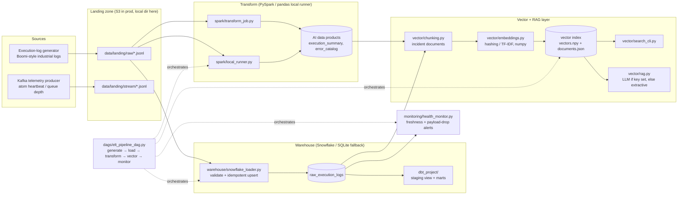

# Enterprise AI Automation & Vector Data Platform

An enterprise data platform that turns high-volume B2B integration execution
logs (Dell Boomi / EDI X12 / SAP, semiconductor supply chain) into governed,
AI-ready data products — with an ELT pipeline into Snowflake, dbt-modeled
marts, Airflow orchestration, Kafka telemetry streaming, and a vector-search
+ RAG layer for semantic incident investigation.

**Everything runs locally and offline.** Snowflake, Spark, Kafka, Airflow,
dbt, and an LLM are all *production targets* behind environment switches;
locally the platform falls back to SQLite, pandas, a file queue, and
extractive RAG answers so the full demo works on a laptop with only
`numpy` + `pandas` installed.

## Architecture



## How the resume bullets map to code

| Resume bullet | Implementation |
|---|---|
| "Architected an automated ELT pipeline on AWS S3 and Snowflake ingesting high-volume industrial logs…" | `ingestion/log_generator.py` → landing zone (`data/landing/`, the S3 stand-in) → `warehouse/snowflake_loader.py` (Snowflake connector when `SNOWFLAKE_*` env vars are set, SQLite locally; validated, idempotent upserts into `raw_execution_logs`) |
| "…into a vector database for semantic search and Retrieval-Augmented Generation (RAG) models" | `vector/chunking.py` (incident documents), `vector/embeddings.py` (numpy hashing / from-scratch TF-IDF embeddings — no model downloads), `vector/index.py` (persistent local vector index), `vector/search_cli.py`, `vector/rag.py` (grounded prompt assembly; LLM call when `OPENAI_API_KEY` is set, extractive answer otherwise) |
| "Built modular dbt transformation models…" | `dbt_project/` — `stg_execution_logs` staging view, `mart_execution_summary` + `mart_partner_health` marts, `models/schema.yml` with `unique` / `not_null` / `accepted_values` tests |
| "…and scheduled DAG workflows via Apache Airflow to transform raw execution traces into structured AI data products" | `dags/elt_pipeline_dag.py` — hourly DAG: generate → load → transform → vector ingest → health check (CRITICAL alerts fail the run) |
| "Ingested real-time event messaging topics using Apache Kafka to support continuous dataset freshness and automated health monitoring" | `streaming/producer.py` + `streaming/consumer.py` (Kafka via `kafka-python` when `KAFKA_BOOTSTRAP_SERVERS` is set; `streaming/file_queue.py` fallback with the same interface and offset semantics), `monitoring/health_monitor.py` (freshness + payload-drop detection) |
| "AI-ready datasets / structured AI data products" | `spark/transform_job.py` (PySpark) and `spark/local_runner.py` (pandas, identical logic): `execution_summary` and `error_catalog` data products |

## Quickstart — full local demo

```bash
python3 -m venv .venv && source .venv/bin/activate
pip install -r requirements.txt

# 1. Generate execution logs into the landing zone
python -m ingestion.log_generator --count 500 --out data/landing/raw

# 2. Load the landing zone into the warehouse (SQLite locally)
python -m warehouse.snowflake_loader --load-dir data/landing/raw

# 3. Build AI data products (pandas runner; spark/transform_job.py on a cluster)
python -m spark.local_runner --input data/landing/raw --output data/products

# 4. Chunk incidents, embed, and build the vector index
python -m vector.build_index

# 5. Semantic search over incidents
python -m vector.search_cli "AS2 certificate expired partner channel" --k 3

# 6. Ask a question (RAG — extractive offline, LLM if OPENAI_API_KEY is set)
python -m vector.rag "Which partners had SSL certificate problems?" --k 3

# 7. Streaming demo: Kafka-style telemetry via the file-queue fallback
python -m streaming.producer --count 50
python -m streaming.consumer        # lands events in data/landing/stream/

# 8. Health monitoring: freshness + payload-drop alerts
python -m monitoring.health_monitor
```

A small committed sample dataset lives in `data/sample/`
(`execution_logs_sample.jsonl`, 60 records) for quick experiments.

## Tests

```bash
python -m pytest        # 25 tests: loader, validation, embeddings/search, RAG, monitoring
```

## Production configuration

| Capability | Switch |
|---|---|
| Snowflake warehouse | Set `SNOWFLAKE_ACCOUNT`, `SNOWFLAKE_USER`, `SNOWFLAKE_PASSWORD` (+ optional `SNOWFLAKE_WAREHOUSE/DATABASE/SCHEMA`); install `snowflake-connector-python` |
| Kafka streaming | Set `KAFKA_BOOTSTRAP_SERVERS`; install `kafka-python` |
| PySpark transforms | `spark-submit spark/transform_job.py --input <s3 path> --output <s3 path>`; install `pyspark` |
| dbt models | `cp dbt_project/profiles.yml.example ~/.dbt/profiles.yml`, then `dbt build` inside `dbt_project/`; install `dbt-snowflake` |
| Airflow orchestration | Copy/symlink `dags/` into your Airflow `dags_folder`; install `apache-airflow` |
| LLM answers in RAG | Set `OPENAI_API_KEY` (and optionally `OPENAI_MODEL`); install `openai` |

## Project structure

```
.
├── config.py                  # Paths + environment switches (S3/Snowflake/Kafka)
├── ingestion/
│   └── log_generator.py       # Realistic Boomi-style execution-log + telemetry generator
├── warehouse/
│   └── snowflake_loader.py    # Landing -> Snowflake (SQLite fallback), validation, upserts
├── spark/
│   ├── transform_job.py       # PySpark job: raw logs -> AI data products
│   └── local_runner.py        # pandas runner with identical logic (no Spark needed)
├── dbt_project/
│   ├── dbt_project.yml
│   ├── profiles.yml.example
│   └── models/                # staging + marts + schema.yml (dbt tests)
├── dags/
│   └── elt_pipeline_dag.py    # Airflow DAG orchestrating the whole pipeline
├── streaming/
│   ├── producer.py            # Telemetry producer (Kafka or file queue)
│   ├── consumer.py            # Telemetry consumer -> landing zone
│   └── file_queue.py          # Kafka-interface file queue (local fallback)
├── vector/
│   ├── chunking.py            # Execution logs -> incident documents
│   ├── embeddings.py          # Hashing + TF-IDF embedders (numpy, offline)
│   ├── index.py               # Local vector index (npy + JSON persistence)
│   ├── build_index.py         # Index build CLI
│   ├── search_cli.py          # Semantic search CLI
│   └── rag.py                 # Retrieval + prompt assembly + answer (LLM/extractive)
├── monitoring/
│   └── health_monitor.py      # Freshness + payload-drop alerting
├── tests/                     # pytest: loader, validation, vector search, RAG, monitoring
├── data/sample/               # Small committed sample dataset (60 records)
└── requirements.txt           # Core: numpy, pandas, pytest (production extras commented)
```

## Design notes

- **Idempotent loads** — the warehouse loader upserts on `execution_id`, so
  re-running a load (or an Airflow retry) never duplicates data.
- **Validation at the gate** — records are schema/status validated before
  load; rejects are counted and reported, never silently dropped.
- **One transform logic, two engines** — the Spark job and the pandas runner
  implement the same aggregations, so local CI results predict cluster
  results.
- **Payload-drop alerting** — the monitor compares each day's record volume
  against a trailing baseline; silent partner feed failures (the classic B2B
  outage that "succeeds" in the scheduler) raise WARNING/CRITICAL alerts.
